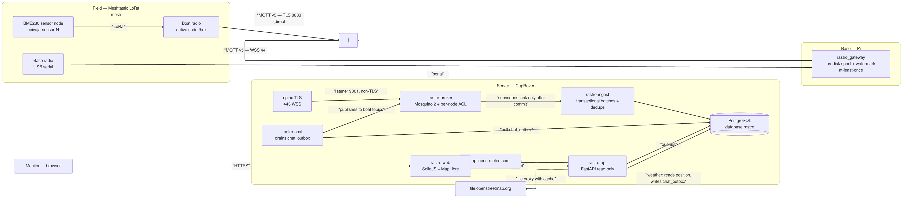
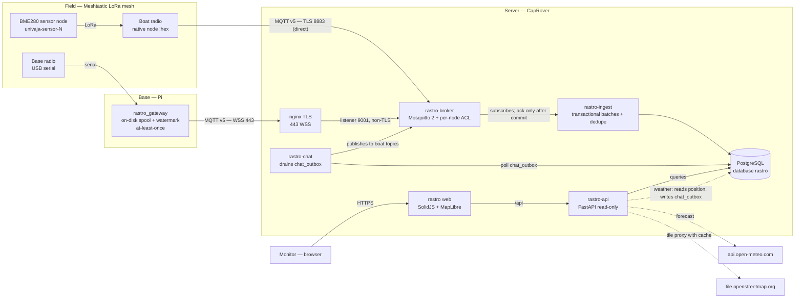
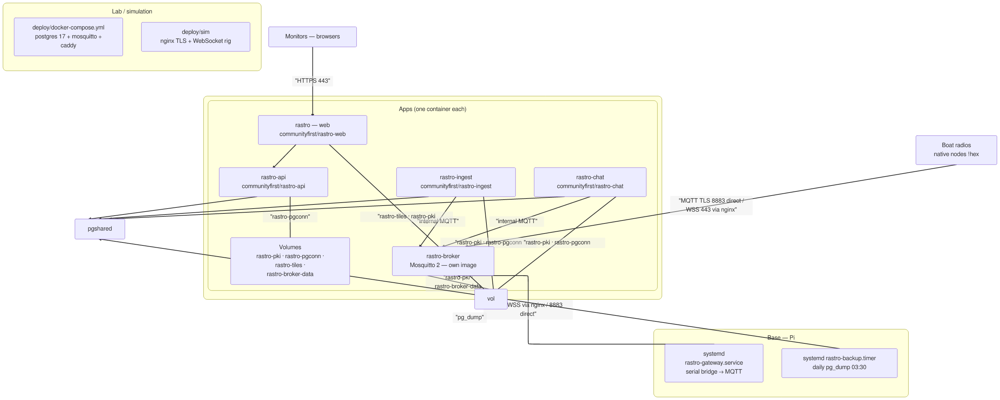
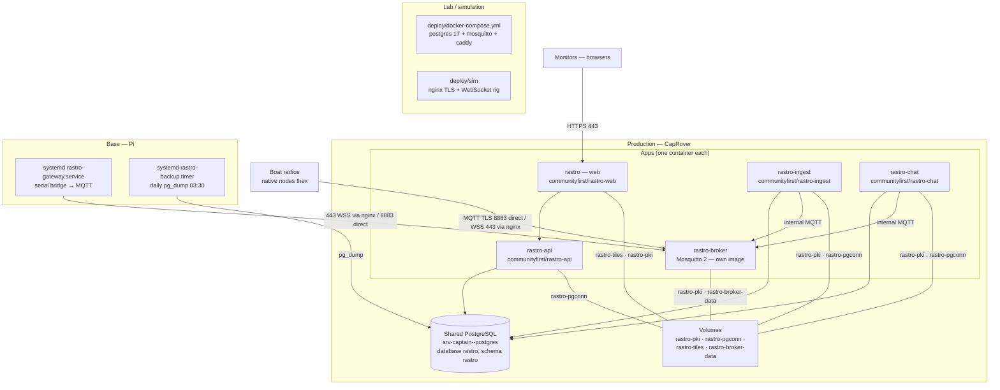

# ARCHITECTURE — Rastro

Autonomous, offline-first platform for tracking a LoRa mesh (Meshtastic) aimed at territorial monitoring. This document describes the architecture of the `rastro` monorepo (public images `communityfirst/rastro-*` on Docker Hub). Updated 2026-11-11. Portuguese version: [ARQUITETURA.md](ARQUITETURA.md).

Index: [Overview](#1-overview) · [Components](#2-components) · [Data flows](#3-data-flows) · [Data model](#4-data-model) · [Security](#5-security) · [Deployment](#6-deployment) · [PostgreSQL connections](#7-postgresql-connections) · [References](#8-references)

## 1. Overview

Three data paths converge on PostgreSQL:

1. **Native nodes** (Meshtastic radios on boats): each radio connects to the broker on its own via MQTT v5/TLS, user `!xxxxxxxx`, password derived from `RASTRO_NATIVE_SECRET`.
2. **Legacy USB gateway**: radio at the base, serial bridge (`rastro_gateway`) with a resilient on-disk spool, publishing over MQTT v5/v3.1.1.
3. **Chat/weather downlink**: messages written to `chat_outbox` (by the API or the weather thread) are drained by `rastro-chat` and published to the boats' topics.

The ingest service drains the broker and writes idempotent transactional batches; the FastAPI API is read-only; the web viewer (SolidJS + MapLibre) runs in the monitors' browsers.

Editable source: [diagrams/data-flow.mmd](diagrams/data-flow.mmd).

## 2. Components

| Component | What it does | Where |
|---|---|---|
| `rastro_gateway` (bridge) | USB serial ↔ MQTT bridge with on-disk spool, watermark and backoff; at-least-once delivery (watermark only advances on a valid PUBACK) | `services/rastro_gateway/bridge/` |
| `rastro_gateway` (native) | Native envelope decoding (`TELEMETRY_APP`, `POSITION_APP`, `NODEINFO_APP`), per-node password derivation, alerts | `services/rastro_gateway/native/` |
| `rastro_gateway` (ingest) | Drains the broker (legacy gateway topics and native `<root>/2/e/#`), writes transactional batches, dedupe (`positions_dedupe`, `packet_seen`), acks only after commit | `services/rastro_gateway/ingest/` |
| `rastro_gateway` (chat) | Drains `chat_outbox` and publishes to the boats' topics (`outbox` account), periodic nodeinfo republish | `services/rastro_gateway/chat/` |
| `rastro-broker` | Mosquitto 2 with per-node accounts/ACL (`accounts.py`); own TLS listener on 8883; with WSS enabled, an additional non-TLS listener on 9001 (Docker internal network only — TLS terminates at nginx 443) | `broker/` |
| `rastro-api` | Read-only FastAPI: `/api/nodes/latest`, `/api/nodes/:id/track`, `/api/nodes/:id/telemetry`, `/api/nodes/:id/environment`, `/api/environment/latest`, `/api/nodes/:id/events`, `/api/alerts`, `/api/chat/*`, `/api/osm/` (tile proxy with cache), `/api/overlays`, token session | `services/rastro_api/api/` |
| `rastro-api` (weather) | Internal thread: daily Open-Meteo forecast per boat, written to `chat_outbox` (`created_by='clima'`); off by default (`RASTRO_CLIMA_ENABLED=1` enables) | `services/rastro_api/api/clima_agenda.py` |
| `rastro` (web) | Tactical viewer, SolidJS + MapLibre GL: offline PMTiles, geodesic bearing, GPS dwell/spike analysis, measuring ruler, floating panels, Sensors block | `web/` |
| Deploy | Docker Compose templates, idempotent PostgreSQL bootstrap (dedicated roles), additive migrations, CapRover simulation | `deploy/` |

## 3. Data flows

### 3.1 Native uplink (boats)

1. The boat's radio connects to the broker: user = node id (`!xxxxxxxx`), password = `base64url(HMAC-SHA256(RASTRO_NATIVE_SECRET, b"node:"+user))` truncated to 30 characters; publishes to `<root>/2/e/<channel>/<id>` (root `univaja/mesh`, channel EVU).
2. The ACL guarantees each boat reads only its own virtual gateway topic (`sha256(b"rastro-vgw:"+boat)`) — no boat sees another boat's traffic.
3. Ingest subscribes `<root>/2/e/#`, decodes the envelope, stores the raw payload in `raw_envelopes` and the parts in their target tables, in a transactional batch; the MQTT ack only goes out after commit. A failed commit means redelivery, absorbed by `packet_seen`.
4. Environmental telemetry (`environment_metrics`, BME280) from the sensor node rides the boat's own uplink (the sensor has no MQTT account) and lands in `environment_telemetry`.

### 3.2 Legacy uplink (USB gateway)

Serial radio at the base → `bridge`: packet filter, on-disk spool (watermark), publish to the broker with QoS and exponential backoff; a PUBACK with code ≥ 128 or a timeout does not advance the watermark. Cross-thread synchronization tolerates early acks.

### 3.3 Downlink (chat and weather)

1. The web writes a message to `chat_outbox` via `POST /api/chat/send`.
2. `rastro-chat` polls the outbox, encrypts with the EVU channel key and publishes to the boat's virtual gateway topic; same watermark discipline as the spool.
3. Weather thread (inside the API): one attempt per boat per day, idempotency via advisory lock + `created_by='clima'` check; text 150–180 bytes (cap 200); logs carry no coordinates. Known limitation: if `rastro-chat` is down, messages pile up in the outbox and all go out together when it returns.
4. Text uplink from the boats follows the native uplink path (MQTT → ingest) and lands in `chat_messages`; the web reads it via `GET /api/chat/messages`.

### 3.4 Tiles and layers

- Default basemap: `/api/osm/{z}/{x}/{y}.png` — the API fetches `tile.openstreetmap.org` with an in-memory cache; the browser never talks to OSM.
- Optional PMTiles (`basemap.pmtiles` on the `rastro-tiles` volume): fully offline map.
- `/api/overlays`: GeoJSON layers (villages, boundaries) fetched and cached for 1 h.

### 3.5 Track history (web)

`GET /api/nodes/:id/track` without `from`/`to` returns 24 h, capped at 2000 fixes per call (the newest ones). The web fetches the chosen period (24 h to 14 days) in UTC day slices, splits slices that hit the cap into disjoint halves, and caches closed days (15 min + jitter).

### 3.6 Alerts

Cycle in the ingest service (`RASTRO_ALERTS_ENABLED`, `services/rastro_gateway/native/alerts.py`): evaluates per-node rules (e.g. no movement, battery), records transitions in `alert_state`, and the web lists them via `GET /api/alerts`. No active notification today — the plan (alerts that notify) is in `docs/PLANO-ALERTAS-E-RETENCAO.md`.

## 4. Data model

Database `rastro`, schema `rastro`, on the server's shared PostgreSQL. Migrations are **additive and idempotent only** (`init/01-schema.sql`, `02-native.sql`, `migrate-02/03/04`); never `DROP`/`RENAME`/type changes on tables used by ingest/api.

**Tracking:**

| Table | Contents |
|---|---|
| `nodes` | Registration and last state per node |
| `positions` | GPS fixes (dedupe via `positions_dedupe`) |
| `device_telemetry` | Radio telemetry (battery, voltage…) |
| `environment_telemetry` | BME280: temperature, humidity, pressure (dedupe `(node_num, telem_time)`) |

**Native / mesh:**

| Table | Contents |
|---|---|
| `raw_envelopes` | Raw payloads per topic |
| `packet_seen` | MQTT redelivery dedupe |
| `gateway_status` | Gateway status/LWT |
| `node_info` | Mesh NodeInfo |
| `node_power` | Node power |

**Chat and configuration:**

| Table | Contents |
|---|---|
| `chat_messages` | Messages received from boats |
| `chat_outbox` | Messages to send (web and weather) |
| `virtual_gateways` | Virtual gateways per boat (seeded from `RASTRO_NATIVE_NODES`) |
| `boat_devices` | Devices per boat |
| `alert_state` | Alert state (no movement, battery…) |

**Roles** (created by the bootstrap, each with its own password): `rastro_owner` (owner), `rastro_ingest` (INSERT on `nodes`/`positions`/`device_telemetry`/`environment_telemetry` plus column-level UPDATE on `nodes`; INSERT/SELECT/UPDATE on the native tables, `alert_state` and `virtual_gateways`/`boat_devices`; SELECT/UPDATE on `chat_outbox`), `rastro_viewer` (read + INSERT restricted to `chat_outbox`), `rastro_maint` (retention), `rastro_backup` (dump).

## 5. Security

- **TLS on every field→server path**: the Mosquitto TLS listener on 8883 (port mapped directly on the broker app, outside nginx); with WSS on, an additional **non-TLS** listener on 9001, restricted to the Docker internal network — TLS terminates at nginx (443). Native nodes authenticate with an HMAC-derived password (`broker/derive.py`; identical in 4 implementations — see the frozen contract).
- **Per-node isolation**: per-account ACL; a boat reads only its own downlink topic; `retain` only for LWT on `stat/<id>`; no service publishes with retain.
- **Read-only API in two layers**: `viewer` role in the database **and** `default_transaction_read_only=on` on the API's pool connections (defense in depth, `services/rastro_api/api/main.py:241`).
- **HTTPS required** (`RASTRO_REQUIRE_HTTPS`): the API answers 403 without HTTPS; token session (`/api/auth/sessao`).
- **Territorial secrecy**: no logging of payloads, coordinates or keys/PSKs; OSM tiles go through the API (monitors' IPs never reach OSM); `.env` files, channel keys and real coordinates never enter the repository.
- **Frozen contract** (2026-10-06): password derivation, secret, EVU channel, topic root, port 8883, topic format, virtual gateway id and database schema **do not change** without an owner-approved migration plan — see section 5 of `AGENTS.md`. Field radios only come back with a physical/USB visit.

## 6. Deployment

Editable source: [diagrams/deploy-topology.mmd](diagrams/deploy-topology.mmd).

### Production (CapRover, verified 2026-11-11)

| App | Image | Role |
|---|---|---|
| `rastro` | `communityfirst/rastro-web:0.8.11` | Viewer (static) |
| `rastro-api` | `communityfirst/rastro-api:0.8.11` | API + weather thread |
| `rastro-broker` | `communityfirst/rastro-broker:0.8.4` | Mosquitto (per-node accounts/ACL) |
| `rastro-ingest` | `communityfirst/rastro-ingest:0.8.9` | Legacy + native ingest, alerts |
| `rastro-chat` | `communityfirst/rastro-chat:0.8.4` | Chat downlink |

Volumes: `rastro-pki` (CA/certificates), `rastro-pgconn` (Postgres host/port published by setup, no password), `rastro-tiles` (optional PMTiles), `rastro-broker-data`. Operations: `scripts/rastro_caprover.py status|deploy-image|set-env` (dry-run by default).

### Other environments

- **Base Pi**: `systemd/rastro-gateway.service` (serial bridge) and `rastro-backup.timer` (local rotating pg_dump, 14 copies, 03:30; off-site is a separate step).
- **Lab**: `deploy/docker-compose.yml` — postgres 17, mosquitto (+ `mosquitto-posse`), pg-bootstrap, ingest, api, web, caddy (+ `caddy-remote`).
- **Simulation**: `deploy/sim` — reproduces nginx with TLS + WebSocket to the broker, native e2e with a bench-test radio.
- **CI**: push to `main` publishes `communityfirst/rastro-web:sha-<7>`; full release via `scripts/rastro_release.sh X.Y.Z --push` (a `v*` tag makes CI rebuild everything).

## 7. PostgreSQL connections

Who opens a connection to the database (code):

| Service | Pool | idle | cap | Where |
|---|---|---|---|---|
| `rastro-api` | `psycopg_pool.ConnectionPool` (read-only) | 1 | 4 | `services/rastro_api/api/main.py:236` |
| `rastro-ingest` | `db.Db` → `ConnectionPool` | 1 | 4 | `services/rastro_gateway/ingest/db.py:234` |
| `rastro-chat` | `db.Db` → `ConnectionPool` | 1 | 4 | `services/rastro_gateway/chat/__main__.py:214` |

- **Steady state: 3 connections** (1 per pool). **Pool ceiling: 12** (3 × 4). The weather thread uses the API's pool, it does not open its own.
- **Transients**: the daily `pg_dump` (base Pi, 03:30, +1) and maintenance/migration jobs with the `maint`/`backup` roles (on demand, +1–2). The CapRover `<app>-setup` app only exists during installation.
- **Zero connections**: broker, gateway (MQTT only), web (static, in the browser), native nodes, monitors.
- **No PgBouncer**: no pooler in the path; the pools are small by design.
- **Server**: shared one-click PostgreSQL (`srv-captain--postgres`), **no `max_connections` override in the repository** → default 100 (3 reserved for superuser). The same 100 are contested with the server's other apps; Rastro takes 3–12.

## 8. References

- `AGENTS.md` — architecture lessons and the **frozen contract** (section 5).
- `docs/ARQUITETURA.md` — Portuguese version of this document.
- `docs/native-ingest-design.md` — native ingest design.
- `docs/OPERACAO-caprover.md` — CapRover installation and operations.
- `docs/SEGURANCA.md` — security and territorial secrecy.
- `docs/PLANO-ALERTAS-E-RETENCAO.md`, `docs/PLANO-environment-sensor.md` — per-domain plans.
- `docs/historico/rastro-todo-2026.md` — decision history and evidence; open items on the `tsk` board.
- Diagrams: [data-flow.mmd](diagrams/data-flow.mmd) · [deploy-topology.mmd](diagrams/deploy-topology.mmd) (PNG next to each `.mmd`). Portuguese diagrams: `fluxo-dados.mmd`, `deploy-topologia.mmd`.

